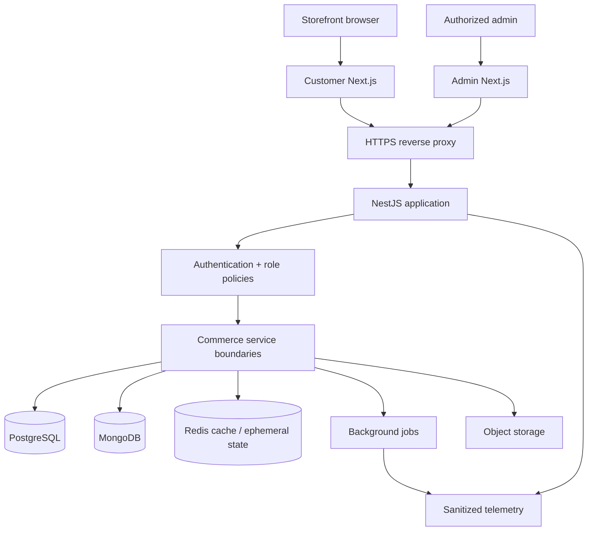

# ShopBani — Public-Safe Architecture

**Logical components, not an inventory of real deployments.** Data flows and responsibility boundaries are representative; actual implementations may differ.

## Core invariants
- **Order status:** Paid / failed / cancelled transitions must be defined centrally and idempotent under repeated payment callbacks.
- **Permission model:** Client/admin UI role assertions do not substitute for backend enforcement.
- **Inventory / carts:** Cache loss must not corrupt source-of-truth data.
- **Uploads:** Content type/size and object URLs are validated, storage credentials are server-side.
- **Notifications:** Retries cannot produce uncontrolled duplicates; durable record of outcomes is preferred.
- **Observability:** Correlate edge / API / persistence / queue failures without recording private order data.
- **AI analytics:** Connector operations are scoped and read-only by default; timestamps and financial units explicitly documented.

## Diagnostic playbook: incident class, not a reported incident
1. Verify public edge status vs internal API health.
2. Segment error rate by endpoint, HTTP status and time window.
3. Check process pressure/worker concurrency before attributing latency.
4. Evaluate database/Redis health separately.
5. Verify job backlogs, external dependencies and media storage.
6. Document the root cause using timestamped evidence; avoid publishing live keys, sensitive logs and IPs.

## Disclosure & maturity
The proprietary source code and production runbooks are not included. Refer to [CASE_STUDY.md](CASE_STUDY.md) for concrete engineering examples and [ROADMAP.md](ROADMAP.md) for further evidence work.
