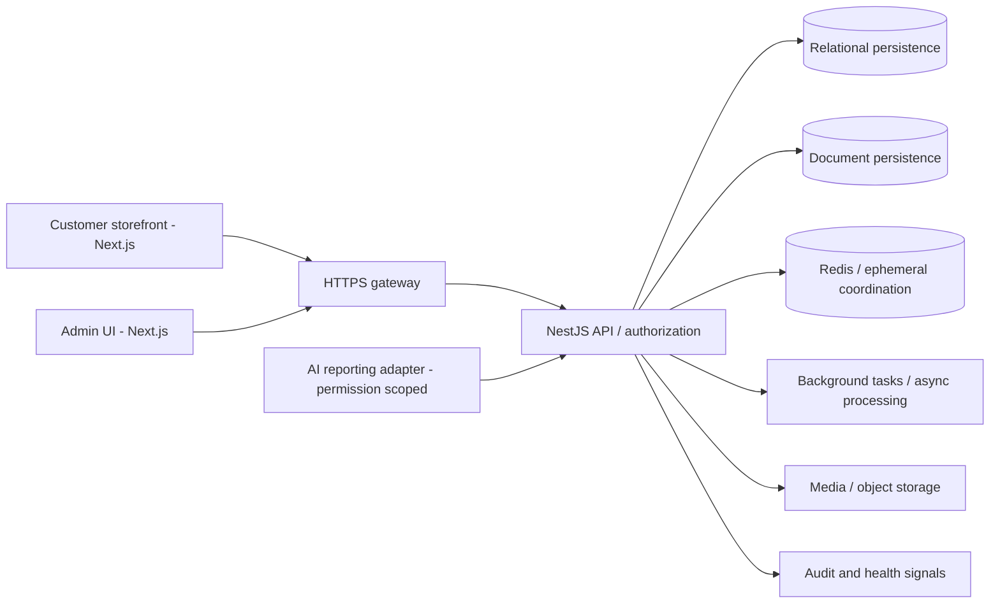

# ShopBani — Operations-Oriented Full-Stack Engineering Case Study

**Portfolio scope:** product / backend / operational integration, not an independent audit. **Publication date:** 2026-10-13. This write-up is based on project-level engineering context; live source and measurement logs are private.

## 1. Business & technical problem
A commerce platform must connect a fast storefront, administrator tools and an authoritative order lifecycle while supporting payment transitions, media uploads, notifications, reporting and periods of peak traffic. The engineering challenge is the *end-to-end interaction* among app code, queues, stores and hosting — not just a visually functioning checkout.

## 2. My engineering scope
The project work described in this public case study spans:
- Client-facing Next.js storefront and a distinct administrative surface.
- NestJS business API with permission-aware service boundaries.
- Postgres-oriented relational workflows; MongoDB for suitable document-shaped data; Redis-backed ephemeral/cache/queue use cases.
- Asset upload/object-storage integration and delivery over HTTPS.
- Production operations: VPS deployment, reverse-proxy/routing, service restarts, dependency health and resource diagnostics.
- Integration design for **read-only, evidence-aware AI business reporting** rather than granting a chatbot unrestricted database access.

Specific repositories, dates, server IPs, customer identifiers, financial volume and contractual details are deliberately withheld.

## 3. Sanitized architecture

This diagram is a **conceptual** public model, not a current production topology map.

## 4. Operational lessons (real problem categories, redacted)

### A. Deployment and reverse proxy migration
**Situation:** Moving a multi-surface Node stack from managed hosting to a Linux VPS requires correct service separation, proxy routing, TLS termination and process lifecycle management.  
**Engineering response:** Separate frontend/admin/backend service units; verify upstream readiness and edge routing; retain rollback/restart procedures and record dependency health.  
**Why it matters:** A responsive homepage does not show whether the API, Redis, persistence or background work is healthy.  
**Evidence boundary:** Service names, exact configs, uptime and migration success percentages are not included here.

### B. Secure media URL composition
**Situation:** A media/object-storage URL with an incorrect scheme or separator breaks assets even when uploads succeed.  
**Engineering response:** Normalize URL construction and test generated links at the API/UI boundary; avoid hard-coded paths in clients.  
**Why it matters:** A small integration bug can affect the visible user journey.  
**Validation to publish next:** sanitized fixture verifying that resulting media URLs have a valid HTTPS scheme, safe hostname and correct path, without private bucket paths.

### C. Diagnosing slow responses / resource pressure
**Situation:** Elevated application load can stem from CPU, query plans, worker concurrency, caching behavior, connection exhaustion or ineffective retry loops.  
**Engineering response:** Collect time-correlated health signals across API, Redis, database, reverse proxy and background worker, then separate symptom from cause.  
**Why it matters:** Scaling hardware without identifying the bottleneck can conceal faults and increase costs.  
**Evidence boundary:** No fabricated “X% faster” or “zero downtime” claim is made.

### D. Reporting without unbounded database access
**Situation:** Management wants natural-language answers like “What drove the weekly sales drop?”  
**Engineering direction:** A read-only adapter supplies role-limited aggregated data, explicit date windows and currency units; deterministic calculations and evidence provenance precede AI explanation.  
**Risk reduction:** Keeps operational and permission decisions in trusted code rather than model-generated queries.  
**Status boundary:** Public code in this repository does not demonstrate live production deployment of the AI reporting adapter.

## 5. Trade-offs
| Choice | Benefit | Cost / limitation |
| --- | --- | --- |
| Distinct customer/admin apps | Clear user experiences and deployment responsibilities | Multiple build/release paths |
| Relational + document stores | Flexibility for different data shapes | Complexity of consistency and observability |
| Redis / asynchronous tasks | Better latency isolation for appropriate workloads | Retries and idempotency need careful design |
| Explicit service monitoring | Faster isolation of failures | Monitoring itself requires maintenance |
| Read-only AI adapter | Lower authorization/data-integrity risk | Limited supported question vocabulary |

## 6. Verification and measured outcomes
No independently verifiable performance benchmark, transaction volume, customer count or availability percentage is published here. Useful evidence to publish **after redaction and approval** includes:
- Trace of a synthetic checkout operation (API → payment state → queue → notification).
- Before/after profiling method with sample size and infrastructure conditions.
- Synthetic fault injection (Redis timeout, storage failure, API 5xx) with expected graceful degradation.
- Narrowed read-only AI analytics test fixture with documented units.

The accompanying [offline demo](demo/index.html) uses fabricated values, **not real revenue**.

## 7. What I would improve next
1. Formalize dependency health and service-level alert thresholds.
2. Build reproducible synthetic API tests around critical checkout/payment state transitions.
3. Implement immutable correlations for asynchronous jobs and idempotent retries.
4. Add automated performance/regression dashboards and redacted incident postmortems.
5. Publish an explicitly permitted demo and evidence report, keeping private internals private.
